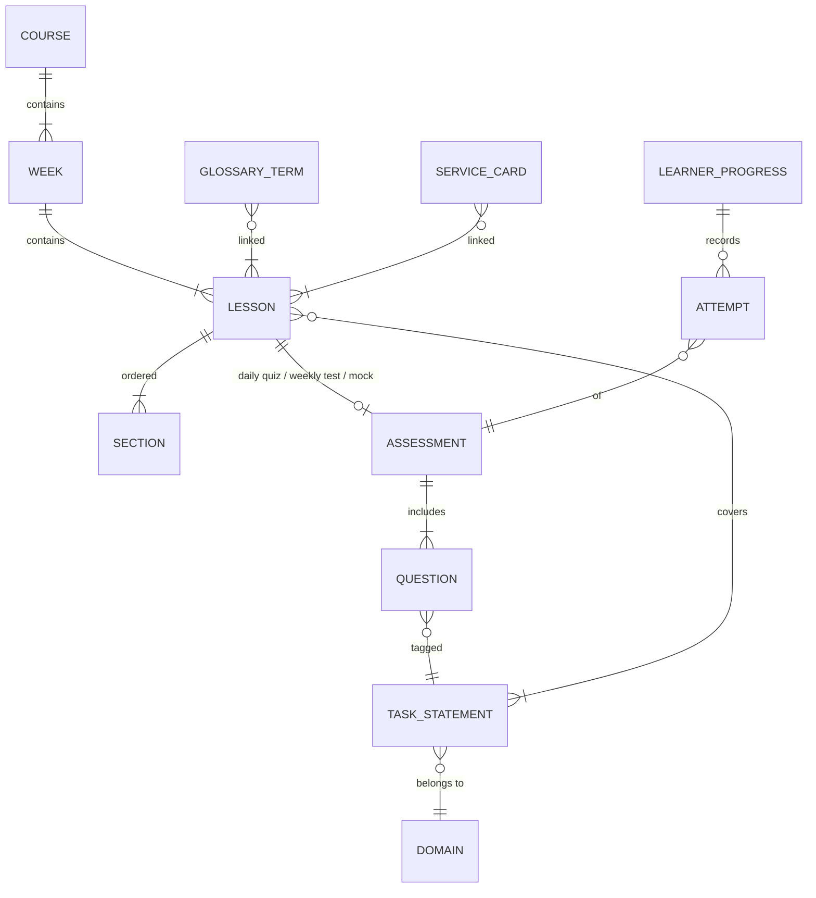
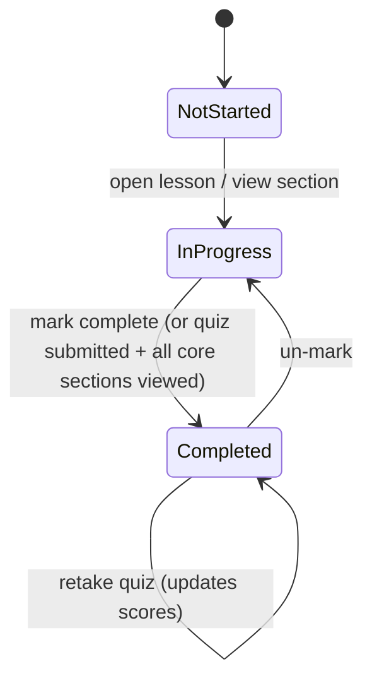

# Data Model: AWS AI Practitioner 30-Day Course Website

All content entities are authored as files in the repo and validated at build. Learner state lives only in the browser.

## Content entities (build-time)

### ExamGuide (`src/data/exam-guide.yaml`)
| Field | Type | Rules |
|-------|------|-------|
| examCode | string | `AIF-C01` |
| version | string | e.g. `1.2` |
| publishedOn | date | |
| lastVerified | date | ≤ today |
| format | object | `{ totalQuestions: 65, scored: 50, minutes: 90, passScaled: 700, scaleMin: 100, scaleMax: 1000 }` |
| domains | Domain[] | exactly 5; weights sum to 100 |
| inScopeServices / outOfScopeServices | string[] | no overlap |

### Domain
| Field | Type | Rules |
|-------|------|-------|
| id | `D1`..`D5` | unique |
| name | string | |
| weight | int % | 20/24/28/14/14 |
| color | token | theme token |
| tasks | TaskStatement[] | |

### TaskStatement
| Field | Type | Rules |
|-------|------|-------|
| id | string `\d\.\d` | unique, e.g. `3.2` |
| title | string | |
| objectives | string[] | |

### Course / Week
- Course: `title`, `examGuideVersion`, `weeks[]`.
- Week: `number` 1–5, `title`, `dayRange`, `reviewDay` (7/14/21/28; none for week 5), `badgeId`.

### Lesson (`src/content/lessons/day-NN.mdx`)
Frontmatter contract: [contracts/lesson-frontmatter.schema.json](contracts/lesson-frontmatter.schema.json)

| Field | Type | Rules |
|-------|------|-------|
| day | int 1–30 | unique |
| kind | `lesson` \| `review` \| `mock` | review on 7/14/21/28; mock on 29/30 |
| title, summary | string | summary ≤ 900 characters (≈120 words) |
| domains | DomainId[] | ≥1 |
| taskStatements | string[] | each exists in ExamGuide |
| sources | `{ provider: udemy\|skillbuilder\|aws-docs, title, url? }[]` | ≥1 for `lesson` |
| objectives | string[] | 3–7 |
| estimatedMinutes | int | core sum 50–70 for `lesson` |
| lastVerified | date | |
| sections | Section[] | order fixed (see below) |

### Section (MDX component blocks within a lesson)
Required order for `kind: lesson`:
`recap` (Day 1: `orientation`) → `objectives` → `explanation` → `diagram`(≥1) → `examples` → `realWorld`(≥1) → `handsOn` → `examTips` → `summary` → `quiz` → `deepDive` (optional, flagged `optional: true`, has ≥1 architecture diagram).

| Field | Type | Rules |
|-------|------|-------|
| id | slug | unique within lesson; used for deep links & resume |
| type | enum above | |
| minutes | int | excluded from core when `optional` |
| optional | bool | true only for `deepDive` |

### HandsOn (read-through lab)
`goal`, `steps[] {text, visual(svg path), caption}`, `expectedOutcome`, `asOf` date, `checks[]` (2–3 scenario questions, not counted in quiz). No step may require AWS resource creation.

### Question (`src/content/questions/*.yaml`)
Contract: [contracts/question.schema.json](contracts/question.schema.json)

| Field | Type | Rules |
|-------|------|-------|
| id | string `q-<set>-<nnn>` | globally unique |
| set | `day-NN` \| `week-N` \| `mock-N` | |
| type | `single` \| `multi` \| `ordering` \| `matching` | |
| stem | markdown | |
| options | `{id, text, explanation}[]` | single: 4; multi: ≥5; ordering: 3–5; matching: 3–7 pairs |
| answer | ids / ordered ids / pairs | multi: ≥2 correct |
| explanation | markdown | why correct |
| domain | DomainId | |
| taskStatement | string | exists in ExamGuide |
| lessonRef | `day-NN#section-id` | resolvable |
| difficulty | `easy`\|`medium`\|`hard` | |

Set-level rules: daily 15–20 (target 20); weekly 55–60 (target 57); total unique ≥ 900; mock exactly 65 with domain split 13/16/18/9/9; no question id appears in more than one set; mock stems not duplicated from other sets.

### GlossaryTerm / ServiceCard (`src/content/glossary/*.yaml`, `src/content/services/*.yaml`)
- GlossaryTerm: `term`, `definition`, `examCue`, `lessonRefs[]`.
- ServiceCard: `name`, `category`, `purpose` (1 line), `examCue` ("Choose this when…"), `notThis` (common confusion), `inScope` bool, `lessonRefs[]`.

## Learner state (browser, runtime)

Contract: [contracts/progress-schema.json](contracts/progress-schema.json) — key `aip-course:v1` in `localStorage`.

### LearnerProgress
| Field | Type | Notes |
|-------|------|-------|
| schemaVersion | 1 | migrations keyed by version |
| examGuideVersion | string | content version at time of save |
| startedAt | ISO datetime | |
| lastPosition | `{ day, sectionId, updatedAt }` | drives "Continue" |
| days | map day → DayState | |
| attempts | Attempt[] | all assessment attempts |
| inProgress | map assessmentId → InProgressAttempt | survives navigation |
| streak | `{ current, longest, lastStudyDate }` | |
| badges | string[] | `week-1`..`week-4`, `mock-pass`, `streak-7` |
| settings | `{ theme: light\|dark }` | |
| ratings | map week → 1–5 | FR-026 engagement rating |

### DayState (state machine)

Fields: `status`, `sectionsViewed[]`, `completedAt?`, `bestScore?`, `latestScore?`.

### Attempt
`id`, `assessmentId`, `kind` (`daily`|`weekly`|`mock`), `startedAt`, `submittedAt`, `answers` (questionId → answer), `score {correct, total, percent, scaled?}`, `byDomain {D1..D5: {correct,total}}`, `flagged[]`, `autoSubmitted` bool.

### InProgressAttempt
`assessmentId`, `answers`, `flagged[]`, `startedAt`, `deadline?` (mock only). On reload, if `deadline` passed → auto-submit.

### Derived values
- Overall % = completed days / 30.
- Weak domains = domains with < 70% across last attempts (min 5 answered).
- Streak increments when a day is completed on a new calendar date consecutive to `lastStudyDate`.
