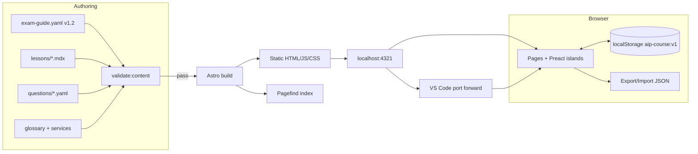

# Implementation Plan: AWS AI Practitioner 30-Day Course Website

**Branch**: `001-aws-ai-practitioner-course` | **Date**: 2026-11-02 | **Spec**: [spec.md](spec.md)

**Input**: Feature specification from `/specs/001-aws-ai-practitioner-course/spec.md`

## Summary

Build a local, static, colourful Udemy-style course website that delivers a 30-day × ~60-minute programme for the AWS Certified AI Practitioner exam (AIF-C01, **exam guide v1.2, published 2026-10-29**, verified live). Each day has recap, first-principles explanation, Mermaid diagrams, examples, real-world scenarios, a no-AWS-account read-through lab, exam tips, a 15–20 question quiz, and an optional Architect Deep Dive. Weekly reviews (Days 7/14/21/28) and three full 65-question mock exams complete the programme, with 900+ unique questions. Progress is stored in the browser with export/import, resume, streaks and badges.

Technical approach: Astro 5 static site with MDX content collections (schema-validated), Preact islands for interactive parts, Tailwind CSS v4 theme, bundled Mermaid, Pagefind search, Vitest + Playwright tests, and a content validator that enforces exam coverage. Full analysis in [research.md](research.md).

### Key analysis findings (from live research)

1. **Exam guide v1.2 added material the provided courses do not cover**: agentic AI, multi-agent patterns, MCP, Amazon Bedrock AgentCore (incl. Identity & Policy), Strands Agents, Kiro, Amazon Quick, Amazon Nova, AWS Transform, Bedrock Prompt Management, context engineering, prompt caching, distillation, LLM-as-a-judge, hallucination grounding/confidence scoring, and the Generative AI Security Scoping Matrix. These get dedicated lessons (Days 10, 12, 13, 15, 16, 20, 25, 26, 27).
2. **Outdated material**: AWS DeepLens (discontinued) and AWS WAF (now explicitly out of scope) are shown only as exam traps.
3. **Re-weighting**: Classical-AI theory from Udemy (search, logic, knowledge representation, association rules, RL variants) is reduced to background; time is spent in proportion to D1 20% / D2 24% / D3 28% / D4 14% / D5 14%.
4. **Exam format**: 65 Q (50 scored), 90 min, pass 700/1000; types are multiple choice, multiple response, ordering, matching. Mocks mirror this.

## Technical Context

**Language/Version**: TypeScript 5.x, Node.js 22 LTS (build only)

**Primary Dependencies**: Astro 5, @astrojs/mdx, @astrojs/preact, Tailwind CSS v4, mermaid (bundled), Pagefind, Zod (via Astro content collections), Ajv (progress import + content scripts)

**Storage**: Content: MDX/YAML files in repo. Learner state: browser `localStorage` key `aip-course:v1` + JSON export/import

**Testing**: Vitest (unit), Playwright + @axe-core/playwright (e2e & a11y), custom `validate:content` script (coverage/completeness)

**Target Platform**: Modern evergreen browsers (desktop + mobile) served from localhost:4321, optionally via VS Code port forwarding

**Project Type**: Static content web application (single project, no backend)

**Performance Goals**: Lesson page interactive < 2 s on local network; search results < 1 s; mock exam UI responsive with 65 questions

**Constraints**: No backend, no login, no external CDNs/hosting at runtime; no AWS account needed; root-relative links; WCAG AA contrast

**Scale/Scope**: 30 day pages (24 lesson days, 4 review days, 2 mock days), 3 mock runners, ≥903 questions, ~60+ diagrams, ~150 glossary terms, ~60 service cards, ~15 routes

## Constitution Check

*GATE: Must pass before Phase 0 research. Re-check after Phase 1 design.*

Checked against the ratified constitution v1.0.0 ([.specify/memory/constitution.md](../../.specify/memory/constitution.md)):

| Principle | Pre-research | Post-design | How the plan complies |
|-----------|--------------|-------------|-----------------------|
| I. Exam-Guide Fidelity | PASS | PASS | `exam-guide.yaml` v1.2, `lastVerified` per lesson, validator scope checks, T-final currency re-check |
| II. Test-First Delivery | PASS | PASS | Every task in tasks.md carries TC / Plan / Verify; content tasks have page E2E + answer-key tests |
| III. Multi-Model Swarm Review | PASS | PASS | Reviewer model matrix in tasks.md; review-log per task |
| IV. Visual & E2E Verification | PASS | PASS | Playwright screenshots desktop+mobile, light+dark; phase regression; final audit task |
| V. Design-First Experience | PASS | PASS | Phase 0 design reference, tokens and approved mockups before UI work |
| VI. Accessibility | PASS | PASS | axe on every route, keyboard tests, captions |
| VII. Simplicity, Privacy & Security | PASS | PASS | Static site, no backend, validated import, CSP, no AWS account |

## Project Structure

### Documentation (this feature)

```text
specs/001-aws-ai-practitioner-course/
├── plan.md              # This file
├── research.md          # Exam analysis, gap analysis, 30-day curriculum, tech decisions
├── data-model.md        # Content & learner-state entities
├── quickstart.md        # Run & validation scenarios
├── contracts/
│   ├── lesson-frontmatter.schema.json
│   ├── question.schema.json
│   ├── progress-schema.json
│   └── ui-routes.md
├── checklists/requirements.md
└── tasks.md             # /speckit-tasks output (not created here)
```

### Source Code (repository root)

```text
site/
├── astro.config.mjs
├── package.json
├── public/
│   └── labs/                     # annotated SVG console mock-ups for read-through labs
├── scripts/
│   └── validate-content.ts       # coverage, counts, uniqueness, section order, scope checks
├── src/
│   ├── data/
│   │   ├── exam-guide.yaml       # v1.2 domains, task statements, in/out-of-scope services
│   │   └── course.yaml           # weeks, badges, day → kind map
│   ├── content/
│   │   ├── config.ts             # Zod collections mirroring contracts/*.json
│   │   ├── lessons/              # day-01.mdx … day-30.mdx
│   │   ├── questions/            # day-NN.yaml, week-N.yaml, mock-N.yaml
│   │   ├── glossary/*.yaml
│   │   └── services/*.yaml
│   ├── components/
│   │   ├── lesson/               # Callout, Diagram (Mermaid), Recap, HandsOnLab, DeepDive, SectionNav
│   │   ├── quiz/                 # QuizRunner, Single/Multi/Ordering/Matching, Results (Preact)
│   │   ├── mock/                 # MockRunner, Timer, Palette, ReviewScreen (Preact)
│   │   └── dashboard/            # ProgressRing, ContinueCard, Streak, Badges, WeakDomains (Preact)
│   ├── lib/
│   │   ├── progress/             # store, migrations, export/import (Ajv-validated)
│   │   ├── scoring.ts            # percent, scaled, by-domain
│   │   └── streak.ts
│   ├── layouts/                  # BaseLayout, LessonLayout
│   ├── pages/                    # routes per contracts/ui-routes.md
│   └── styles/theme.css          # Tailwind v4 tokens, domain colours, light/dark
└── tests/
    ├── unit/                     # Vitest
    └── e2e/                      # Playwright (+ axe)
```

**Structure Decision**: Single static project in `site/` keeps the repo root free for Spec Kit artifacts. Content (MDX/YAML) is separated from components so the ~900 questions and 30 lessons can be authored and validated independently of UI work.

## Architecture Overview



## Implementation Phasing (input for /speckit-tasks)

0. **Design (Principle V)**: design reference = Figma Community “Online Learning Platform (2019)” (EduEra dashboard + course frames; captures in `specs/001-aws-ai-practitioner-course/design/`). Sampled tokens: purple `#503E9D`/`#6553B2`, orange `#FB6D3A`, white panels, `#F6F6F5` inputs, Poppins (self-hosted). Produce `site/design/tokens.json` and mockups under `site/src/pages/_design/` adapted for AA contrast, mobile bottom-tab layout and dark theme; approved screenshots become the visual baseline.
1. **Foundation**: scaffold Astro project, theme, layouts, content collections + schemas, `exam-guide.yaml`, validator skeleton.
2. **P1 – Lesson + Quiz + Resume (US1–US3)**: lesson components, quiz runner, progress store, dashboard, Days 1–3 content as a vertical slice.
3. **P2 – Reviews, Mocks, Lookup (US4–US6)**: weekly review page, mock runner, glossary, cheat sheets, coverage matrix, Pagefind.
4. **P3 – Engagement (US7)**: streaks, badges, animations, dark mode, mobile pass.
5. **Content production**: Days 4–30 lessons, question sets, mocks — authored week by week, each week gated by `validate:content`.
6. **Verification**: Quickstart V1–V15 and a final content-currency check against the live exam guide.

## Complexity Tracking

No constitution violations to justify.
