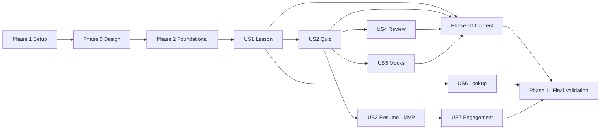

# Tasks: AWS AI Practitioner 30-Day Course Website

**Input**: Design documents from `/specs/001-aws-ai-practitioner-course/`

**Prerequisites**: [plan.md](plan.md), [spec.md](spec.md), [research.md](research.md), [data-model.md](data-model.md), [contracts/](contracts/), [quickstart.md](quickstart.md), [constitution v1.0.0](../../.specify/memory/constitution.md)

**Tech stack**: Astro 5 + MDX content collections, Preact islands, Tailwind CSS v4, Mermaid rendered to SVG at build time (mermaid-isomorphic), Pagefind, Ajv, Vitest, Playwright + @axe-core/playwright. All code lives in `site/`.

**Tests**: MANDATORY (Constitution II). Every task lists **TC** (test cases), **Plan** (ordered steps) and **Verify** (commands, expected results, screenshots).

## Format

```text
- [ ] T### [P?] [US?] Description with file path
  - TC: test case ids + Given/When/Then (or reference to a standard suite)
  - Plan: ordered implementation steps
  - Verify: commands → expected result; screenshots to inspect
```

---

## Quality Gate (applies to EVERY task — Constitution II, III, IV)

1. **Red**: write/extend tests from TC → run → confirm they FAIL for the expected reason.
2. **Green**: implement per Plan → tests PASS.
3. **Static**: `npm run lint`, `npm run typecheck`, `npm run validate:content` clean.
4. **Visual**: for any visible change, `npm run test:visual -- <spec>` captures desktop 1280×800 + mobile 375×812 (light + dark where relevant) into `site/tests/e2e/__screenshots__/`. **Open every PNG and inspect** (layout, overlap, truncation, colours vs. design tokens, diagrams rendered, no horizontal scroll). Approve baseline only after inspection; afterwards `toHaveScreenshot` with `maxDiffPixelRatio: 0.01`.
5. **Commit**: `T###: <summary>`.

The **multi-model swarm review runs once at the end** (task T181, Constitution v2.0.0 Principle III), not per task:

| Perspective | Checks | Reviewer model (differs from author Claude Opus) |
|-------------|--------|--------------------------------------------------|
| Spec + Security | FR/SC/acceptance coverage; no untrusted HTML, validated import, CSP, no external runtime requests | GPT-6.1 Sol (copilot) |
| Exam content + UX/Visual + Accessibility | Accuracy vs AIF-C01 v1.2; answer keys; screenshots vs Figma (≤ 10 images per call); keyboard, contrast, captions | Gemini 4 Argon (copilot) |

If a model is unavailable, use any available model that differs from the author and record it.

### Standard test suites (referenced by content tasks)

**TC-L — lesson day page** (`site/tests/e2e/content-day.spec.ts`, parametrised by day; content check in `scripts/validate-content.ts`)
- L1 Given the day is registered in `course.yaml`, When validate runs, Then a lesson file exists with frontmatter valid per [lesson-frontmatter.schema.json](contracts/lesson-frontmatter.schema.json).
- L2 Sections appear in order recap→objectives→explanation→diagram→examples→realWorld→handsOn→examTips→summary→quiz→deepDive.
- L3 ≥1 diagram renders (build-time Mermaid SVG `` with alt + `figcaption`); Deep Dive contains ≥1 architecture diagram.
- L4 Real-world callout present; Hands-on shows goal, ≥3 steps with visual + caption, expected outcome, `asOf`, 2–3 checks, "No AWS account needed".
- L5 Recap content references Day N−1 title and ≥3 of its key points.
- L6 Estimated core minutes from content (words ÷ 130 study-reading wpm + diagrams × 1 + lab 8 + 1 min per quiz question) is 50–70 and within ±15% of `estimatedMinutes` (implemented in `site/src/lib/validate.ts`).
- L7 `taskStatements` match research.md A5 for the day; every out-of-scope service mention has an `examTraps` entry.
- L8 Screenshots `day-NN-top`, `day-NN-lab`, `day-NN-deepdive` desktop + mobile captured and inspected.

**TC-Q — question set** (`site/tests/unit/question-sets.test.ts`, parametrised by set)
- Q1 Count within set rule (daily 15–20 target 20; weekly 55–60 target 57; mock exactly 65).
- Q2 Every question valid per [question.schema.json](contracts/question.schema.json); ids unique globally; no stem reused across sets.
- Q3 Every option has an explanation; `answer` ids exist in options.
- Q4 Every `lessonRef` resolves to an existing section id.
- Q5 Type mix ≈70% single / 20% multi / 10% ordering+matching (±10%).
- Q6 Domain/task-statement tags match the day's `taskStatements` (daily) or weighting (weekly/mock).
- Q7 Independent answer-key review by the Exam-content reviewer model: every answer re-derived without seeing the key; disagreements fixed.

---

## Phase 0: Design (Principle V)

**Purpose**: Approved visual reference before any UI work.

**Design reference (approved by learner)**: Figma Community “Online Learning Platform (2019)” — https://www.figma.com/design/0gnQfjdofgUuc1byuM3YRC/Online-Learning-Platform--2019---Community-?node-id=55-0 — captured in `specs/001-aws-ai-practitioner-course/design/figma-*.png` (2026-11-02). Two desktop frames:
- **Desktop-1 (Dashboard)** → our `/`: deep-purple app shell, left sidebar (logo, Home/Progress/Messages/Settings, active item as a white tab merging into the content panel, “Support 24/7” illustration card), large white rounded content panel, pill search bar, “Your unfinished courses” gradient image cards with orange duration pill, “Live lessons” thumbnail row with arrow.
- **Desktop-2 (Course/lesson)** → our `/day/NN`: collapsed icon sidebar, breadcrumb title (“Course – …”), large media card (we use the day’s hero diagram), lesson title + author row + like/comment counts, description; right column “Lessons” list with orange numbered square icons (we use the day’s section list) and two pastel cards.

**Sampled tokens** (from screenshots): brand purple `#503E9D`, purple-2 `#6553B2`, accent orange `#FB6D3A`, orange-soft `#FDA484`, surface `#FFFFFF`, input bg `#F6F6F5`; geometric sans (Poppins-like) — self-host via `@fontsource/poppins` (no CDN, Principle VII).

**Adaptations required** (Figma file is desktop-only and pre-dates our features):
- White text on `#FB6D3A` is ~2.9:1 (fails AA) → use orange for fills/icons with dark text, or `#C2410C` for white-text buttons.
- Mobile (375px) not designed → sidebar becomes a bottom tab bar; content panel full-width; cards stack.
- Domain colours D1–D5 are used only for chips/accents inside the white panel so they don’t clash with the purple shell.
- Dark theme not designed → derive: shell `#1E1838`, panel `#2A2350`, keep orange accent.
- Photos in the Figma file are not reused; we use diagrams/illustrations we own.

- [x] T001 Create design tokens in site/design/tokens.json from the sampled Figma values above plus domain colours (D1 #2563EB, D2 #7C3AED, D3 #EA580C, D4 #16A34A, D5 #DC2626) and callout colours (Tip teal, Exam Trap red, Real-world amber, Hands-on indigo, Remember pink, Deep Dive slate); typography (Poppins 400/500/600/700, scale 12/14/16/20/24/32), spacing 4-pt, radii (panel 32, card 20, pill 999), shadows; light + derived dark
  - TC: D1 Given tokens.json, When contrast is computed for every declared text/background pair, Then all ≥ 4.5:1 (normal) / 3:1 (large) in light and dark (site/tests/unit/design-tokens.test.ts); D1b brand values equal the sampled Figma hexes.
  - Plan: 1) write contrast + Figma-parity test; 2) draft tokens; 3) adjust text-on-orange pairs until AA passes.
  - Verify: `npm run test -- design-tokens` → pass.
- [x] T002 Build static design mockups in site/src/pages/design/ (Astro ignores `_`-prefixed routes) replicating the Figma frames with our content: dashboard.astro (Desktop-1 layout: “Continue where you left off” = unfinished-course cards, “This week” = live-lessons row), lesson.astro (Desktop-2 layout: hero diagram card, section list with orange numbered icons), plus quiz.astro, results.astro, mock.astro, review.astro in the same visual language; add mobile bottom-tab variant
  - TC: D2 each mockup renders; D3 no horizontal scroll at 375px; D4 screenshots `design-<page>` desktop+mobile, light+dark; D5 side-by-side comparison image of `design-dashboard-desktop` vs `figma-d1-a.png` and `design-lesson-desktop` vs `figma-d2-b.png`.
  - Plan: 1) write site/tests/e2e/design.spec.ts (`@visual`); 2) build shell (sidebar + panel) and pages; 3) capture.
  - Verify: `npm run test:visual -- design` → screenshots inspected next to Figma captures; UX reviewer confirms structure, colours, radii, typography match.
- [x] T003 Design approval: record approved screenshots as baseline and the Figma→site mapping decisions in specs/001-aws-ai-practitioner-course/reviews/review-log.md
  - TC: D6 all 6 mockups × 2 viewports × 2 themes approved by UX + Accessibility reviewers; deviations from Figma listed with reason.
  - Plan: 1) inspect screenshots next to Figma captures; 2) iterate; 3) save baselines.
  - Verify: review-log entry with 24 approved screenshots.

> Note: T001–T003 need the project scaffold; run Phase 1 T004–T010 first, then Phase 0, then Phase 2.

---

## Phase 1: Setup

- [x] T004 Scaffold Astro 5 TypeScript project in site/ (site/package.json, site/astro.config.mjs with `@astrojs/mdx`, `@astrojs/preact`, `base: '/'`, `server: { host: true, port: 4321 }`, `preview: { host: true, port: 4321 }`)
  - TC: S1 Given a fresh clone, When `npm run build`, Then exit 0 and `dist/index.html` exists.
  - Plan: 1) scaffold minimal template; 2) add integrations; 3) set host/port.
  - Verify: `npm run build` → success.
- [x] T005 Install dependencies in site/package.json: `@tailwindcss/vite`, `tailwindcss`, `mermaid`, `ajv`, `ajv-formats`, `js-yaml`, `@fontsource/poppins`; dev: `typescript`, `tsx`, `vitest`, `jsdom`, `@playwright/test`, `@axe-core/playwright`, `pagefind`, `@astrojs/check`, `eslint`, `typescript-eslint`, `prettier`; then `npx playwright install chromium` (Node ≥ 22.19 recommended — current 22.17.1 gives EBADENGINE warnings from `undici`)
  - TC: S2 `npm ls` has no missing peer deps.
  - Plan: install; pin exact versions.
  - Verify: `npm ls --depth=0` clean.
- [x] T006 [P] Configure strict TypeScript (site/tsconfig.json), ESLint flat config with `no-restricted-properties` banning `innerHTML`/`outerHTML` (site/eslint.config.js), Prettier (site/.prettierrc)
  - TC: S3 A fixture file using `innerHTML` makes `npm run lint` fail.
  - Plan: add rule; add fixture under site/tests/fixtures/lint/; exclude fixture from normal lint.
  - Verify: `npm run lint` clean; fixture check fails as expected.
- [x] T007 [P] Configure Vitest in site/vitest.config.ts (include `tests/unit/**/*.test.ts`, environment `jsdom`)
  - TC: S4 A sample test runs.
  - Verify: `npm run test` → 1 passing.
- [x] T008 [P] Configure Playwright in site/playwright.config.ts: `webServer` build+preview on 4321; projects `desktop` (1280×800) and `mobile` (375×812); `snapshotPathTemplate: 'tests/e2e/__screenshots__/{testFilePath}/{arg}-{projectName}{ext}'`; `expect.toHaveScreenshot.maxDiffPixelRatio: 0.01`; `use.screenshot: 'on'`
  - TC: S5 A sample spec opens `/` on both projects and saves a screenshot.
  - Verify: `npm run test:e2e` → pass; PNGs present.
- [x] T009 Add npm scripts in site/package.json: `dev`, `build` (`astro build && pagefind --site dist`), `preview`, `lint`, `typecheck` (`astro check`), `test`, `test:e2e`, `test:visual` (`playwright test --grep @visual`), `validate:content` (`tsx scripts/validate-content.ts`), `verify` (lint+typecheck+validate:content+test+test:e2e), `audit:tasks` (`tsx scripts/audit-tasks.ts`)
  - TC: S6 every script exits 0 on the scaffold (validate/audit scripts as stubs).
  - Verify: `npm run verify` → pass.
- [x] T010 [P] Create site/.gitignore and specs/001-aws-ai-practitioner-course/reviews/review-log.md with the log template from the Quality Gate
  - TC: S7 `dist`, `node_modules`, `test-results`, `playwright-report`, `.astro` ignored.
  - Verify: `git status` shows none of them.
- [x] T011 REVIEW Phase 1: run `npm run verify`
  - TC: all S1–S7 green.
  - Verify: review-log entry.

---

## Phase 2: Foundational (blocks all stories)

### Tests first (must FAIL)

- [x] T012 [P] Unit test exam guide data in site/tests/unit/exam-guide.test.ts
  - TC: F1 `examCode`=`AIF-C01`, `version`=`1.2`, `publishedOn`=`2026-10-29`; F2 5 domains weights 20/24/28/14/14 sum 100; F3 exactly 14 task statements (1.1–1.3, 2.1–2.3, 3.1–3.4, 4.1–4.2, 5.1–5.2); F4 `format`=`{ totalQuestions: 65, scored: 50, minutes: 90, passScaled: 700, scaleMin: 100, scaleMax: 1000 }`; F5 in-scope ∩ out-of-scope = ∅ and out-of-scope contains `AWS WAF`.
  - Verify: red now (file missing).
- [x] T013 [P] Unit tests for schemas in site/tests/unit/schemas.test.ts with fixtures site/tests/fixtures/{questions,lessons,progress}/
  - TC: F6 per question type valid+invalid ("single: options 4, answer 1"; "multi: options ≥5, answer ≥2"; "ordering: options 3–5"; "matching: options 3–7 + matchTargets"); F7 id pattern `^q-(day-\d{2}|week-[1-4]|mock-[1-3])-\d{3}$`; F8 `lessonRef` pattern `^day-\d{2}#[a-z0-9-]+$`; F9 lesson `estimatedMinutes` 50–70 for `kind: lesson`; F10 **Ajv and Zod parity**: every fixture is accepted/rejected identically by the Ajv validator and the Zod collection schema.
  - Verify: red.
- [x] T014 [P] Unit tests for content validator in site/tests/unit/validate-content.test.ts with fixtures site/tests/fixtures/content/{valid,invalid-*}/
  - TC: F11 missing/out-of-order section; F12 L6 time estimate outside 50–70 or >±15% off declared; F13 set count rules (daily 15–20, weekly 55–60, mock 65 with split D1 13/D2 16/D3 18/D4 9/D5 9); F14 duplicate id / reused stem; F15 task statement <3 questions; F16 unresolvable `lessonRef`; F17 out-of-scope service without `examTraps`; F18 lesson without diagram/realWorld/deepDive; F19 total unique < 900 (only when `--final`); F20 days registered in `course.yaml` without content reported as "pending" (not error) unless `--final`.
  - Verify: red.
- [x] T015 [P] Unit tests for scoring in site/tests/unit/scoring.test.ts
  - TC: F21 percent; F22 scaled = `round(100 + 900 × correct/total)`; F23 pass iff scaled ≥ 700; F24 multi correct only on exact set; F25 ordering exact order; F26 matching all pairs; F27 unanswered = incorrect; F28 `byDomain` totals.
  - Verify: red.
- [x] T016 [P] Unit tests for progress store in site/tests/unit/progress-store.test.ts
  - TC: F29 default state valid per [progress-schema.json](contracts/progress-schema.json), key `aip-course:v1`; F30 corrupt JSON → default + `recovered` flag, original backed up to `aip-course:v1:backup`; F31 `setLastPosition`, `markSectionViewed` (unique), `markDayComplete`/`unmarkDay`, `saveInProgress`, `recordAttempt` (best/latest), `setRating(week, 1–5)`, `reset`; F32 `attempts` capped at 500 (oldest dropped).
  - Verify: red.
- [x] T017 [P] Unit tests for export/import in site/tests/unit/progress-io.test.ts
  - TC: F33 export is schema-valid JSON; F34 import rejects > 1 MB, non-JSON, schema-invalid, `schemaVersion` ≠ 1 with friendly messages; F35 import returns summary and does not mutate until `confirm()`; F36 `<script>` strings stored as plain text.
  - Verify: red.
- [x] T018 [P] E2E foundation test in site/tests/e2e/foundation.spec.ts (`@visual`)
  - TC: F37 home loads; nav links present (Dashboard, Outline, Search, Glossary, Cheat sheets, Settings); F38 theme toggle switches and persists; F39 footer "Exam guide v1.2 · last verified 2026-11-02"; F40 CSP meta present; screenshots `foundation-home-light`, `foundation-home-dark`.
  - Verify: red.

### Implementation

- [x] T019 Create site/src/data/exam-guide.yaml from research.md A1–A3
  - Plan: domains, colours from tokens, 14 task statements + objectives, in/out-of-scope lists, dates.
  - Verify: T012 green.
- [x] T020 [P] Create site/src/data/course.yaml (5 weeks; day → kind: lesson on 1–6, 8–13, 15–20, 22–27; review on 7/14/21/28; mock on 29/30; per-day `taskStatements` from research.md A5; badges `week-1..week-4`, `mock-pass`, `streak-7`, `course-complete`)
  - TC: F41 30 days, 24 lesson / 4 review / 2 mock (add to exam-guide.test.ts).
  - Verify: test green.
- [x] T021 [P] Copy contracts to site/src/schemas/*.json and create site/src/schemas/index.ts exporting compiled Ajv validators
  - Verify: T013 F6–F9 green.
- [x] T022 Define content collections in site/src/content.config.ts (`lessons` MDX now; `questions`/`glossary`/`services` YAML collections are added in T058/T103/T104 when their first files exist) with Zod schemas mirroring the contracts
  - Verify: T013 F10 parity green.
- [x] T023 Implement site/scripts/validate-content.ts (rules F11–F20; prints coverage per task statement and pending days; `--final` mode)
  - Verify: T014 green; `npm run validate:content` exit 0 on empty content (all pending).
- [x] T024 [P] Implement site/src/lib/scoring.ts (`scoreQuestion`, `scoreAttempt`, `toScaled`, `isPass`, `byDomain`)
  - Verify: T015 green.
- [x] T025 [P] Implement site/src/lib/progress/store.ts (normalises optional fields; migrations.ts deferred until schemaVersion 2 exists)
  - Verify: T016 green.
- [x] T026 [P] Implement site/src/lib/progress/io.ts (download `aip-progress-YYYY-MM-DD.json`; import 1 MB limit, `JSON.parse` only, Ajv, two-step confirm)
  - Verify: T017 green.
- [x] T027 [P] Implement theme in site/src/styles/theme.css from site/design/tokens.json (Tailwind v4 `@theme`, `data-theme` light/dark)
  - TC: F42 computed CSS variables equal token values (unit test site/tests/unit/theme-tokens.test.ts).
  - Verify: test green.
- [x] T028 Create site/src/layouts/BaseLayout.astro (header nav, theme toggle, footer with exam guide version + lastVerified, CSP `<meta http-equiv="Content-Security-Policy" content="default-src 'self'; img-src 'self' data:; style-src 'self' 'unsafe-inline'">`, skip link)
- [x] T029 [P] Create site/src/components/lesson/Callout.astro (tip, examTrap, realWorld, handsOn, remember, deepDive)
- [x] T030 [P] Create site/src/components/lesson/Diagram.astro (`code` + required `caption` props → `` of build-time SVG rendered by site/scripts/render-diagrams.ts, `<figcaption>`; no runtime Mermaid so strict CSP holds)
- [x] T031 Create placeholder site/src/pages/index.astro using BaseLayout
  - Verify (T028–T031): T018 green; screenshots match Phase 0 dashboard header/footer styling.
- [x] T032 REVIEW Phase 2: `npm run verify`; inspect screenshots

**Checkpoint**: Foundation ready.

---

## Phase 3: User Story 1 — Daily lesson (P1) 🎯 MVP

**Goal**: Complete lesson page; Days 1–3 authored. **Independent test**: `/day/02` sections in order, recap of Day 1, 50–70 min core (quickstart V2, V3).

### Tests first

- [x] T033 [P] [US1] Unit tests in site/tests/unit/lesson-utils.test.ts
  - TC: U1 `getRecap(n)` returns Day n−1 title + key points; Day 1 → `orientation`; U2 `coreMinutes()` excludes `optional`; U3 `estimateMinutes(content)` (in validate.ts) = core words÷130 + diagrams×1 + lab 8 + 1 min per quiz question, optional sections excluded (matches L6 accepted deviation); U4 `getPrevNext`.
- [x] T034 [P] [US1] Parametrised content spec site/tests/e2e/content-day.spec.ts (`@visual`) implementing TC-L L2–L5, L8 for every day whose content exists
  - TC: TC-L.
- [x] T035 [P] [US1] Unit spec site/tests/unit/question-sets.test.ts implementing TC-Q Q1–Q6 for every existing set
  - TC: TC-Q.
- [x] T036 [P] [US1] E2E site/tests/e2e/lesson-ui.spec.ts (`@visual`)
  - TC: U5 sticky section nav highlights current section; U6 Deep Dive collapsed + "Optional" label; U7 prev/next; U8 skip-ahead notice on `/day/03` with Day 2 incomplete, dismissible, non-blocking; U9 Day 1 orientation shows 65 Q / 90 min / pass 700 / 4 question types; screenshots `lesson-nav`, `lesson-deepdive-open`, `day1-orientation`.

### Implementation

- [x] T037 [US1] Implement site/src/lib/lesson-utils.ts → T033 green
- [x] T038 [P] [US1] Create site/src/components/lesson/Recap.astro and site/src/components/lesson/Orientation.astro (facts from exam-guide.yaml)
- [x] T039 [P] [US1] Create site/src/components/lesson/SectionNav.astro (sticky desktop, collapsible mobile)
- [x] T040 [P] [US1] Create site/src/components/lesson/HandsOnLab.astro (`goal`, `steps[{text, visual, caption}]`, `expectedOutcome`, `asOf`, `checks[]`, "No AWS account needed" banner)
- [x] T041 [P] [US1] Create site/src/components/lesson/DeepDive.astro (`<details>`, "Optional · Architect Deep Dive · N min")
- [x] T042 [P] [US1] Create site/src/components/lesson/Section.astro (id, type, heading, minutes badge, domain accent)
- [x] T043 [US1] Create site/src/layouts/LessonLayout.astro (hero, domain chips, objectives, minutes, sources list, section slots, prev/next, skip-ahead island)
- [x] T044 [US1] Create site/src/pages/day/[day].astro (`getStaticPaths` from course.yaml; renders LessonLayout for `kind: lesson`, "Coming soon" card for pending days)
  - Verify (T038–T044): T036 green; screenshots vs. Phase 0 lesson mockup.
- [x] T045 [US1] Author site/src/content/lessons/day-01.mdx + labs site/public/labs/day-01/*.svg — Orientation (exam v1.2 format & domains, study method), AI vs ML vs DL vs GenAI vs agentic AI (nested diagram), history timeline; real-world (recommendations, fraud detection); lab "Tour of Bedrock & SageMaker AI consoles"; Deep Dive "Where each AI layer runs on AWS" (TS 1.1)
  - TC: TC-L for day 01 + facts: F4 values shown match exam-guide.yaml.
  - Plan: 1) register day 1 content expected → content-day spec red; 2) author; 3) SVG labs; 4) green.
  - Verify: `npm run test:e2e -- content-day --grep "day 01"`; `npm run validate:content`; inspect `day-01-*` screenshots; Exam-content reviewer.
- [x] T046 [US1] Author site/src/content/lessons/day-02.mdx + site/public/labs/day-02/ — model, algorithm, training vs inference, fit/overfit/underfit, bias–variance diagram, inference types batch/real-time/async/serverless decision diagram; lab "SageMaker AI endpoint types"; Deep Dive "Choosing an inference pattern" (TS 1.1, 4.1)
  - TC: TC-L day 02 + recap references Day 1. Verify: as T045.
- [x] T047 [US1] Author site/src/content/lessons/day-03.mdx + site/public/labs/day-03/ — data types; supervised (regression, classification), unsupervised (clustering, PCA, association), reinforcement, self-supervised; decision-tree diagram; lab "SageMaker Canvas no-code prediction"; Deep Dive "Data → model type mapping" (TS 1.1, 1.2)
  - TC: TC-L day 03. Verify: as T045.
- [x] T048 [US1] REVIEW US1: T033–T036 green for Days 1–3; inspect all screenshots
  - Done 2026-11-02: unit 133 passing, E2E 40 passing (content-day, lesson-ui, design, foundation), lint/typecheck/validate:content clean. Accepted deviations: (a) lab visuals are owned HTML console mock-ups (`ConsoleMock.astro`) inside `<figure>` + `<figcaption>` instead of `site/public/labs/day-NN/*.svg`; (b) `keyPoints` added to lesson frontmatter (contract + Zod) as the Recap source; (c) quiz section renders `QuizSlot.astro` placeholder until T058 wires QuizRunner; (d) Exam-content review of Days 1–3 deferred to the single swarm review in T181 (Constitution v2.0.0).

---

## Phase 4: User Story 2 — Daily quiz (P1)

**Goal**: Quiz with 4 question types, results, explanations, best score. **Independent test**: quickstart V4.

### Tests first

- [x] T049 [P] [US2] Unit test site/tests/unit/quiz-state.test.ts
  - TC: Q-S1 answers persist to `inProgress[assessmentId]`; Q-S2 submit creates Attempt with `byDomain`, clears inProgress; Q-S3 DayState best/latest updated.
- [x] T050 [P] [US2] E2E site/tests/e2e/quiz.spec.ts (`@visual`)
  - TC: Q-E1 answer single/multi/ordering/matching by mouse and keyboard only; Q-E2 submit with unanswered → confirm; Q-E3 results show %, correct answer, every option's explanation, "Review in lesson" link to `lessonRef`; Q-E4 reload shows best score; Q-E5 retake; screenshots `quiz-single`, `quiz-ordering`, `quiz-matching`, `quiz-results`.

### Implementation

- [x] T051 [P] [US2] Create site/src/components/quiz/QuestionSingle.tsx (radio group, arrow keys)
- [x] T052 [P] [US2] Create site/src/components/quiz/QuestionMulti.tsx ("Select N")
- [x] T053 [P] [US2] Create site/src/components/quiz/QuestionOrdering.tsx (up/down buttons, keyboard)
- [x] T054 [P] [US2] Create site/src/components/quiz/QuestionMatching.tsx (select per prompt)
- [x] T055 [US2] Implement site/src/lib/quiz-state.ts → T049 green
- [x] T056 [US2] Create site/src/components/quiz/QuizRunner.tsx (progress bar, domain chip, submit confirm)
- [x] T057 [US2] Create site/src/components/quiz/Results.tsx (score ring, per-question review, explanations, lesson links, retake)
- [x] T058 [US2] Wire QuizRunner into LessonLayout quiz section (questions by `set: day-NN`)
  - Verify (T051–T058): T050 green; screenshots vs. Phase 0 quiz/results mockups.
- [x] T059 [P] [US2] Author site/src/content/questions/day-01.yaml (20 Q; TS 1.1)
  - TC: TC-Q for day-01. Plan: 1) register set → Q1 red; 2) author; 3) Q7 answer-key review. Verify: `npm run test -- question-sets`.
- [x] T060 [P] [US2] Author site/src/content/questions/day-02.yaml (20 Q; TS 1.1, 4.1) — TC-Q
- [x] T061 [P] [US2] Author site/src/content/questions/day-03.yaml (20 Q; TS 1.1, 1.2) — TC-Q
- [x] T062 [US2] REVIEW US2: regression US1+US2; self-check answer keys Days 1–3
  - Done 2026-11-02: unit 154 passing, E2E 44 passing (quiz Q-E1–Q-E5 mouse + keyboard on desktop/mobile; lesson-ui + quiz stable over 5 repeats), lint/typecheck/validate:content clean. Answer keys: a blind solve by a second model (Claude Sonnet, key and explanations removed) agreed on 60/60. Fixes from review: q-day-01-016 option b reworded from an absolute claim to the exam hierarchy; q-day-02-018 and q-day-03-015 lessonRefs moved from the optional deep dive to the core section that teaches the answer. Decisions: `questions` collection uses a custom loader (one entry per question, validated by `questionZod`) because each YAML file is an array; a partly matched matching question counts as unanswered; ordering starts from a deterministic shuffle that is never the correct order. The formal Q7 review by the Exam-content reviewer model still runs in T181.

---

## Phase 5: User Story 3 — Resume, dashboard, settings (P1)

**Goal**: Continue in 1 click, progress %, weak domains, outline, export/import/reset. **Independent test**: quickstart V5, V6, V11, V12.

### Tests first

- [ ] T063 [P] [US3] Unit test site/tests/unit/section-tracker.test.ts
  - TC: R1 section ≥50% visible for 3 s → `markSectionViewed` + `setLastPosition`; R2 <3 s → nothing.
- [ ] T064 [P] [US3] Unit test site/tests/unit/weak-domains.test.ts
  - TC: R3 domain weak when < 70% with ≥5 answered over latest attempts; R4 returns linked days.
- [ ] T065 [P] [US3] E2E site/tests/e2e/resume.spec.ts (`@visual`)
  - TC: R5 complete Days 1–2, view Day 3 `hands-on`, reload `/` → 2/30 (7%), Day 3 in progress, Continue → `/day/03#hands-on` in 1 click; R6 in-progress quiz answers retained; R7 weak domains widget lists low domains; screenshot `dashboard-resume`.
- [ ] T066 [P] [US3] E2E site/tests/e2e/settings.spec.ts (`@visual`)
  - TC: R8 export downloads schema-valid JSON; R9 import valid → summary → confirm replaces; R10 malformed / >1 MB rejected with message; R11 reset needs confirmation; screenshots `settings`, `import-confirm`.
- [ ] T067 [P] [US3] E2E site/tests/e2e/outline.spec.ts (`@visual`)
  - TC: R12 weeks → days → sections with status icons + domain chips; pending days marked "Coming soon"; screenshot `outline`.

### Implementation

- [ ] T068 [US3] Implement site/src/lib/progress/section-tracker.ts; mount in LessonLayout → T063 green
- [ ] T069 [US3] Implement site/src/lib/weak-domains.ts → T064 green
- [ ] T070 [P] [US3] Create site/src/components/lesson/MarkComplete.tsx
- [ ] T071 [P] [US3] Create site/src/components/dashboard/ProgressRing.tsx
- [ ] T072 [P] [US3] Create site/src/components/dashboard/ContinueCard.tsx (lastPosition → else next incomplete day → else Day 1)
- [ ] T073 [P] [US3] Create site/src/components/dashboard/WeekTimeline.tsx
- [ ] T074 [P] [US3] Create site/src/components/dashboard/WeakDomains.tsx
- [ ] T075 [US3] Build dashboard site/src/pages/index.astro → T065 green
- [ ] T076 [US3] Build site/src/pages/outline.astro → T067 green
- [ ] T077 [US3] Build site/src/pages/settings.astro + site/src/components/settings/ProgressIO.tsx → T066 green
- [ ] T078 [US3] REVIEW US3 (MVP gate): regression US1–US3; screenshots vs. Phase 0 dashboard

**Checkpoint**: 🎯 MVP — study Days 1–3 with quiz and resume.

---

## Phase 6: User Story 4 — Weekly review (P2)

**Goal**: Review days with domain summary, concept map, 55–60 Q test, per-domain results, engagement rating (FR-026). **Independent test**: quickstart V7.

- [x] T079 [P] [US4] E2E site/tests/e2e/review.spec.ts (`@visual`)
  - TC: W1 summary lists every prior lesson day grouped by domain; W2 concept map renders; W3 results show per-domain bars + "Revisit Day N" links; W4 rating prompt 1–5 saves to `ratings.week-N` and shows on dashboard; screenshots `review-summary`, `review-results`, `review-rating`.
- [x] T080 [P] [US4] Create site/src/components/review/ReviewSummary.astro
- [x] T081 [P] [US4] Create site/src/components/review/DomainResults.tsx
- [x] T082 [P] [US4] Create site/src/components/review/RatingPrompt.tsx (FR-026)
- [x] T083 [US4] Create site/src/layouts/ReviewLayout.astro; render `kind: review` in site/src/pages/day/[day].astro → T079 green
- [x] T084 [US4] REVIEW US4; log
  - Done 2026-11-02: unit 162 passing (new review.test.ts; quiz-state Q-S4 weekly; validator review/mock structure), E2E review.spec 6 passing (W1 on real /day/07 + /day/14; W2–W4 on the test-only fixture route /design/fixture-review rendering tests/fixtures/days/day-07-review.mdx + an 8-question week-1 fixture), quiz.spec regression green; lint/typecheck/validate:content clean; screenshots review-summary/results/rating/page/dark inspected (fixed: list markers in review MDX, "1 of 1 day" grammar, results card). Decisions: the layout (not the MDX) adds summary → test → per-domain results → rating, so review MDX holds only conceptMap/topFacts/traps (contract: contracts/review-and-mock-days.md); weak domain = < 70% (data-model); "Revisit Day N" = lesson days of the missed questions in that domain. Open: W4 "shows on dashboard" belongs to the dashboard (T075, other agent) — `ratings.week-N` is saved and validated here.

---

## Phase 7: User Story 5 — Mock exams (P2)

**Goal**: 65 Q / 90 min mocks with flagging, review, auto-submit, scaled score. **Independent test**: quickstart V8, V9.

- [ ] T085 [P] [US5] Unit test site/tests/unit/mock.test.ts
  - TC: M1 deadline = start + 90 min; M2 remaining time after reload; M3 expired → auto-submit `autoSubmitted: true`; M4 unanswered incorrect; M5 scaled + pass at 700; M6 readiness flag at ≥ 80%.
- [ ] T086 [P] [US5] E2E site/tests/e2e/mock.spec.ts (`@visual`, fixture mock)
  - TC: M7 65 Q, timer 90:00, palette nav, flag/unflag; M8 review screen lists flagged + unanswered; M9 submit → scaled, PASS/FAIL, domains; M10 inject `deadline` = now+3 s, reload → auto-submitted; screenshots `mock-question`, `mock-review`, `mock-results`.
- [ ] T087 [US5] Implement site/src/lib/mock.ts → T085 green
- [ ] T088 [P] [US5] Create site/src/components/mock/Timer.tsx (amber < 10 min, red < 2 min, aria-live every 5 min)
- [ ] T089 [P] [US5] Create site/src/components/mock/Palette.tsx
- [ ] T090 [P] [US5] Create site/src/components/mock/ReviewScreen.tsx
- [ ] T091 [US5] Create site/src/components/mock/MockRunner.tsx
- [ ] T092 [US5] Create site/src/pages/mock/[n].astro (n = 1..3) → T086 green
- [ ] T093 [US5] Create site/src/layouts/MockDayLayout.astro; render `kind: mock` in day route
- [ ] T094 [US5] REVIEW US5; log

---

## Phase 8: User Story 6 — Lookup (P2)

**Goal**: Search, glossary, cheat sheets, coverage matrix. **Independent test**: quickstart V10.

- [ ] T095 [P] [US6] Unit test site/tests/unit/coverage.test.ts
  - TC: K1 task statement → days + question counts; K2 flags < 3 questions.
- [ ] T096 [P] [US6] E2E site/tests/e2e/lookup.spec.ts (`@visual`)
  - TC: K3 search "Guardrails" returns lesson + glossary + service results; K4 search results appear < 1 s after typing (SC-006); K5 glossary A–Z + domain filter; K6 services sheet shows purpose / choose-when / not-this / scope badge, AWS WAF out of scope; K7 metrics sheet; K8 coverage shows 14 task statements; screenshots `search`, `glossary`, `cheatsheet-services`, `cheatsheet-metrics`, `coverage`.
- [ ] T097 [US6] Implement site/src/lib/coverage.ts → T095 green
- [ ] T098 [P] [US6] Build site/src/pages/glossary.astro
- [ ] T099 [P] [US6] Build site/src/pages/cheatsheet/services.astro
- [ ] T100 [P] [US6] Build site/src/pages/cheatsheet/metrics.astro
- [ ] T101 [P] [US6] Build site/src/pages/coverage.astro
- [ ] T102 [US6] Build site/src/pages/search.astro (bundled Pagefind UI; `data-pagefind-body` on lesson, glossary, cheat sheets) → T096 green
- [ ] T103 [P] [US6] Author ~150 glossary terms in site/src/content/glossary/*.yaml
  - TC: K9 each has `term`, `definition`, `examCue`, ≥1 resolvable `lessonRefs` (added to validator). Exam-content review.
- [ ] T104 [P] [US6] Author ~60 service cards in site/src/content/services/*.yaml (all v1.2 in-scope + trap cards: AWS WAF, GuardDuty, Security Hub, Shield, Cognito, DeepLens, Kendra, Amazon Q, A2I, Audit Manager — `inScope: false`, "Beyond the exam")
  - TC: K10 every in-scope service in exam-guide.yaml has a card; every `inScope` flag matches exam-guide.yaml.
- [ ] T105 [US6] REVIEW US6; log

---

## Phase 9: User Story 7 — Engagement (P3)

**Goal**: Streaks, badges, celebration, mobile polish. **Independent test**: quickstart V13, V14.

- [ ] T106 [P] [US7] Unit test site/tests/unit/streak.test.ts
  - TC: E1 consecutive dates increment; E2 gap resets current, keeps longest; E3 same day no double count; E4 badges for week completion, mock pass, streak 7, course complete.
- [ ] T107 [P] [US7] E2E site/tests/e2e/engagement.spec.ts (`@visual`)
  - TC: E5 seeded progress shows streak 7 + Week 1 badge; E6 every route at 375px has `scrollWidth <= clientWidth`; E7 celebration respects `prefers-reduced-motion`; screenshots `dashboard-badges` desktop+mobile.
- [ ] T108 [US7] Implement site/src/lib/streak.ts and site/src/lib/badges.ts → T106 green
- [ ] T109 [P] [US7] Create site/src/components/dashboard/Streak.tsx
- [ ] T110 [P] [US7] Create site/src/components/dashboard/Badges.tsx
- [ ] T111 [P] [US7] Create site/src/components/common/Celebrate.tsx
- [ ] T112 [US7] Integrate into dashboard + MarkComplete; mobile fixes in theme.css → T107 green
- [ ] T113 [US7] REVIEW US7; log

---

## Phase 10: Content Production

Every lesson task: **TC** = TC-L for that day + listed facts; **Plan** = 1) mark day content expected (content-day spec red) 2) live-verify facts in AWS docs 3) author MDX + SVG labs in `site/public/labs/day-NN/` 4) green 5) screenshots; **Verify** = `npm run test:e2e -- content-day --grep "day NN"`, `npm run validate:content`, inspect `day-NN-*` screenshots, Exam-content reviewer (different model).
Every question task: **TC** = TC-Q for that set; **Plan** = register set (red) → author → Q7 independent answer-key review → green; **Verify** = `npm run test -- question-sets`.

### Week 1
- [ ] T114 [P] [US1] Author site/src/content/lessons/day-04.mdx — neural networks, deep learning, CNN, RNN, transformers/attention, transfer learning, CV & NLP; Deep Dive "From pixels/tokens to predictions" (TS 1.1) — TC-L
- [ ] T115 [P] [US2] Author site/src/content/questions/day-04.yaml (20 Q, TS 1.1) — TC-Q
- [ ] T116 [P] [US1] Author site/src/content/lessons/day-05.mdx — AI value, when NOT to use AI, regression/classification/clustering choice, traditional ML vs FM, Comprehend, Transcribe, Translate, Lex, Polly, Rekognition, Textract, Personalize (service decision diagram); Deep Dive "Call-centre analytics pipeline" (TS 1.2) — TC-L
- [ ] T117 [P] [US2] Author site/src/content/questions/day-05.yaml (20 Q, TS 1.2) — TC-Q
- [ ] T118 [P] [US1] Author site/src/content/lessons/day-06.mdx — ML pipeline, data services (S3, Glue, DataBrew, EMR, Lake Formation, Redshift, Data Exchange), SageMaker AI features, FM sources, managed API vs self-hosted, Amazon Quick & Kiro, MLOps, model + business metrics; Deep Dive "End-to-end MLOps on SageMaker AI" (TS 1.3) — TC-L
- [ ] T119 [P] [US2] Author site/src/content/questions/day-06.yaml (20 Q, TS 1.3) — TC-Q
- [ ] T120 [US4] Author site/src/content/lessons/day-07.mdx (`kind: review`) — D1 concept map, top-20 facts, traps — TC: W1–W2 for day 07
- [ ] T121 [US4] Author site/src/content/questions/week-1.yaml (57 new Q, TS 1.1–1.3 + 4.1) — TC-Q
- [ ] T122 REVIEW Week 1 content: regression + screenshots Days 4–7

### Week 2
- [ ] T123 [P] [US1] Author site/src/content/lessons/day-08.mdx — tokens, chunking, embeddings, vectors, transformer LLMs, FMs, multimodal, diffusion; Deep Dive "Embedding pipeline" (TS 2.1) — TC-L
- [ ] T124 [P] [US2] Author site/src/content/questions/day-08.yaml (20 Q, TS 2.1) — TC-Q
- [ ] T125 [P] [US1] Author site/src/content/lessons/day-09.mdx — FM lifecycle, GenAI use cases, token pricing, context engineering; Deep Dive "Context window budget" (TS 2.1) — TC-L
- [ ] T126 [P] [US2] Author site/src/content/questions/day-09.yaml (20 Q, TS 2.1) — TC-Q
- [ ] T127 [P] [US1] Author site/src/content/lessons/day-10.mdx — agentic AI, tools, memory, orchestration, multi-agent patterns, MCP; Deep Dive "Multi-agent system with MCP on AgentCore" (TS 2.1, 3.1) — TC-L
- [ ] T128 [P] [US2] Author site/src/content/questions/day-10.yaml (20 Q, TS 2.1, 3.1) — TC-Q
- [ ] T129 [P] [US1] Author site/src/content/lessons/day-11.mdx — GenAI advantages/limitations, selection factors, business metrics; Deep Dive "Business case for a GenAI assistant" (TS 2.2) — TC-L
- [ ] T130 [P] [US2] Author site/src/content/questions/day-11.yaml (20 Q, TS 2.2) — TC-Q
- [ ] T131 [P] [US1] Author site/src/content/lessons/day-12.mdx — Bedrock (Nova), SageMaker AI & JumpStart, Amazon Quick, Kiro, Strands Agents, AgentCore, AWS Transform; Deep Dive "Bedrock vs SageMaker AI vs Quick" (TS 2.3) — TC-L
- [ ] T132 [P] [US2] Author site/src/content/questions/day-12.yaml (20 Q, TS 2.3) — TC-Q
- [ ] T133 [P] [US1] Author site/src/content/lessons/day-13.mdx — on-demand/batch/provisioned throughput, custom models, prompt caching, regions, Budgets, Cost Explorer; Deep Dive "Cost model for 1M chats/month" (TS 2.3, 3.1) — TC-L
- [ ] T134 [P] [US2] Author site/src/content/questions/day-13.yaml (20 Q, TS 2.3, 3.1) — TC-Q
- [ ] T135 [US4] Author site/src/content/lessons/day-14.mdx (`kind: review`, D1–D2) — TC: W1–W2
- [ ] T136 [US4] Author site/src/content/questions/week-2.yaml (57 new Q, D1–D2) — TC-Q
- [ ] T137 REVIEW Week 2 content; log

### Week 3
- [ ] T138 [P] [US1] Author site/src/content/lessons/day-15.mdx — FM selection criteria, inference parameters, customization spectrum ICL→RAG→fine-tune→distillation→pre-train (TS 3.1) — TC-L
- [ ] T139 [P] [US2] Author site/src/content/questions/day-15.yaml (20 Q, TS 3.1) — TC-Q
- [ ] T140 [P] [US1] Author site/src/content/lessons/day-16.mdx — prompt anatomy, negative prompts, zero/single/few-shot, CoT, templates, best practices, Bedrock Prompt Management (TS 3.2) — TC-L
- [ ] T141 [P] [US2] Author site/src/content/questions/day-16.yaml (20 Q, TS 3.2) — TC-Q
- [ ] T142 [P] [US1] Author site/src/content/lessons/day-17.mdx — injection, hijacking, jailbreaking, poisoning, exposure; Guardrails, output filtering (TS 3.2, 5.1) — TC-L
- [ ] T143 [P] [US2] Author site/src/content/questions/day-17.yaml (20 Q, TS 3.2, 5.1) — TC-Q
- [ ] T144 [P] [US1] Author site/src/content/lessons/day-18.mdx — RAG, Knowledge Bases, chunking, vector stores (OpenSearch, Aurora/RDS PostgreSQL, Neptune, DocumentDB), agents; Deep Dive "Enterprise RAG" (TS 3.1) — TC-L
- [ ] T145 [P] [US2] Author site/src/content/questions/day-18.yaml (20 Q, TS 3.1) — TC-Q
- [ ] T146 [P] [US1] Author site/src/content/lessons/day-19.mdx — pre-training, fine-tuning, continued pre-training, instruction tuning, distillation, RLHF, data prep (TS 3.3) — TC-L
- [ ] T147 [P] [US2] Author site/src/content/questions/day-19.yaml (20 Q, TS 3.3) — TC-Q
- [ ] T148 [P] [US1] Author site/src/content/lessons/day-20.mdx — human eval, benchmarks, Bedrock Model Evaluation, ROUGE/BLEU/BERTScore, LLM-as-a-judge, RAG/agent evaluation, business alignment metrics (TS 3.4) — TC-L
- [ ] T149 [P] [US2] Author site/src/content/questions/day-20.yaml (20 Q, TS 3.4) — TC-Q
- [ ] T150 [US4] Author site/src/content/lessons/day-21.mdx (`kind: review`, D1–D3) — TC: W1–W2
- [ ] T151 [US4] Author site/src/content/questions/week-3.yaml (57 new Q, D1–D3) — TC-Q
- [ ] T152 REVIEW Week 3 content; log

### Week 4
- [ ] T153 [P] [US1] Author site/src/content/lessons/day-22.mdx — responsible AI dimensions, datasets, bias/variance effects, legal risks (TS 4.1) — TC-L
- [ ] T154 [P] [US2] Author site/src/content/questions/day-22.yaml (20 Q, TS 4.1) — TC-Q
- [ ] T155 [P] [US1] Author site/src/content/lessons/day-23.mdx — Guardrails, Clarify, Model Monitor, human review concept, label quality, audits, subgroup analysis, sustainability (TS 4.1) — TC-L
- [ ] T156 [P] [US2] Author site/src/content/questions/day-23.yaml (20 Q, TS 4.1) — TC-Q
- [ ] T157 [P] [US1] Author site/src/content/lessons/day-24.mdx — transparency, explainability, Model Cards, Bedrock Model Evaluations, licensing, trade-offs, human-centred design (TS 4.2) — TC-L
- [ ] T158 [P] [US2] Author site/src/content/questions/day-24.yaml (20 Q, TS 4.2) — TC-Q
- [ ] T159 [P] [US1] Author site/src/content/lessons/day-25.mdx — shared responsibility, IAM, KMS, VPC/PrivateLink, Macie, Secrets Manager, AgentCore Identity & Policy, Guardrails, audit logging, toxicity; Exam Trap WAF/GuardDuty (TS 5.1) — TC-L
- [ ] T160 [P] [US2] Author site/src/content/questions/day-25.yaml (20 Q, TS 5.1) — TC-Q
- [ ] T161 [P] [US1] Author site/src/content/lessons/day-26.mdx — secure data engineering, lineage & cataloguing, Model Cards, hallucination detection, RAG grounding, confidence scoring (TS 5.1) — TC-L
- [ ] T162 [P] [US2] Author site/src/content/questions/day-26.yaml (20 Q, TS 5.1) — TC-Q
- [ ] T163 [P] [US1] Author site/src/content/lessons/day-27.mdx — Config, Inspector, Artifact, CloudTrail, CloudWatch, Trusted Advisor, Well-Architected Tool, data lifecycle/residency/retention, Generative AI Security Scoping Matrix (TS 5.2) — TC-L
- [ ] T164 [P] [US2] Author site/src/content/questions/day-27.yaml (20 Q, TS 5.2) — TC-Q
- [ ] T165 [US4] Author site/src/content/lessons/day-28.mdx (`kind: review`, D1–D5) — TC: W1–W2
- [ ] T166 [US4] Author site/src/content/questions/week-4.yaml (57 new Q, D1–D5) — TC-Q
- [ ] T167 REVIEW Week 4 content; log

### Mocks
- [ ] T168 [P] [US5] Author site/src/content/questions/mock-1.yaml (65 Q, split 13/16/18/9/9, all 4 types) — TC-Q
- [ ] T169 [P] [US5] Author site/src/content/questions/mock-2.yaml (65 Q) — TC-Q
- [ ] T170 [P] [US5] Author site/src/content/questions/mock-3.yaml (65 Q, emphasis on v1.2 additions) — TC-Q
- [ ] T171 [US5] Author site/src/content/lessons/day-29.mdx (`kind: mock`) — Mock 1 launch + remediation plan
  - TC: M11 launch button opens `/mock/1`; remediation lists weak domains after an attempt.
- [ ] T172 [US5] Author site/src/content/lessons/day-30.mdx (`kind: mock`) — Mock 2, optional Mock 3, final revision, exam-day strategy
  - TC: M12 launch buttons for Mock 2 and 3; strategy section lists registration, delivery options, 90 min / 65 Q pacing, question types.
- [ ] T173 REVIEW mocks: `npm run validate:content -- --final` → ≥ 900 unique, every TS ≥ 3, mock splits; Q7 on 100% of mock questions; log

---

## Phase 11: Polish & Final Validation

- [ ] T174 [P] Accessibility suite site/tests/e2e/a11y.spec.ts — TC: axe zero serious/critical on every route desktop+mobile; keyboard-only quiz + mock walkthrough
- [ ] T175 [P] Full visual regression site/tests/e2e/visual.spec.ts (`@visual`) — TC: every route × desktop/mobile × light/dark vs. baselines; inspect all
- [ ] T176 [P] Performance spec site/tests/e2e/perf.spec.ts — TC: P1 lesson page interactive < 2 s with 4× CPU throttling; P2 search results < 1 s; P3 lesson JS < 200 KB gzipped excluding lazy mermaid chunk (script site/scripts/perf-check.ts)
- [ ] T177 Security review — TC: no `innerHTML`/`set:html` on untrusted data (lint + grep), CSP present, zero external requests in Playwright network log, import validation covered by T017; log
- [ ] T178 Content currency re-check — TC: live AIF-C01 guide version/domains/in-scope lists equal site/src/data/exam-guide.yaml; every lesson `lastVerified` updated; `validate:content --final` green
- [ ] T179 Port-forwarding check — TC: `npm run preview -- --host`, forward 4321 in VS Code, forwarded URL loads, export on localhost → import on forwarded URL; screenshot `port-forward`
- [ ] T180 Implement site/scripts/audit-tasks.ts (final task validation) — TC: A1 every task with `@visual` has screenshots on disk; A2 every task's test files exist and pass; A3 reports unchecked tasks
- [ ] T181 Final validation: run quickstart.md V1–V15, `npm run verify`, `npm run audit:tasks`; run the single multi-model swarm review (matrix in Quality Gate) over the whole site incl. screenshots; fix findings; log once in reviews/review-log.md

---

## Dependencies & Execution Order



- Phase 1 runs before Phase 0 (design mockups need the scaffold); Phase 0 must finish before Phase 2 theme/layout tasks.
- Within each task: TC → red → implement → green → screenshots → commit. Swarm review happens once in T181.
- Weekly content can start as soon as US1+US2 exist; review/mock content needs US4/US5.

### Parallel Opportunities

- Setup: T006, T007, T008, T010. Foundational tests T012–T018 all parallel; implementations T020, T021, T024–T027, T029, T030.
- US1 components T038–T042; US2 question components T051–T054 and sets T059–T061.
- US6 parallel with US4/US5 after US1.
- Phase 10: all lesson + question files within a week are [P].

## Implementation Strategy

1. Setup → Design → Foundational.
2. MVP: US1 + US2 + US3 with Days 1–3 (through T078) — start studying.
3. Week 1 content, then US4 (Day 7 usable), US6, US5, US7.
4. Weeks 2–4 content, mocks, final validation (T174–T181).

## Notes

- Constraints from data-model.md are quoted in task TCs; do not relax them.
- Screenshots are always opened and inspected, never only diffed.
- Reviewer model per perspective is recorded in every review-log entry.
